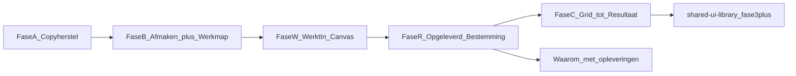

# Eén product ronde 2: herstellen, afmaken, Grid

Ik heb elk punt uit [docs/plans/een-product-ronde-2-prompt.md](docs/plans/een-product-ronde-2-prompt.md) in de code nagelopen. Waar de prompt niet klopt of iets mist, staat dat hieronder bij "Correcties op de prompt". Bij goedkeuring komt dit plan ook in de repo als `docs/plans/een-product-ronde-2-plan.md`.

## Wijzigingen na de review van 20 oktober

Dit blok wijzigt het plan opnieuw, bovenop de correctie hieronder. Er wordt niets gebouwd tot er akkoord is.

**Stand:** A, B1-B6 zijn klaar en op dev. B7 is gestopt vóór migratie 126. B8 (Werkmap) is lokaal grotendeels klaar, nog niet op dev. W, R en C zijn niet begonnen. Dev staat op `125_stage_source`.

**Toegevoegd**

- **B4b, back-up in migratie 124.** Vóór het droppen schrijft 124 elke niet-lege waarde van `signal_tags.send_mode`, `signal_tags.autonomy_level`, `workstreams.autonomy_level` en `contacts.ai_handling` weg in een nieuwe tabel `schema_value_backups`. Downgrade zet ze terug. Migratie 125 doet hetzelfde voor `workstream_stages` en `workstream_stage_owners`, en voor de oude fasenamen die hij hernoemt. Zie B4b.
- **B7, Rapport terug naar Canvas.** De ongecommitte rewrite maakte van het canvas "Rapport" in drie NL-sleutels en twee NL-docs. Die gaan per sleutel terug naar "Canvas" (zie B7).
- **Lens Labels uitgeschreven.** Er komen vier dingen bij: `labels[]` met kleur in de API, `by_label` op elk pad (ook kanaal → uitvoerder), en `open_by_label` per node, waarvan de som gelijk is aan `open`. De lens bestaat in 2D (lijnen in labelkleur) en in 3D (gestapelde zuilen). Er komt een labelchiprij om één label te isoleren, de actie "Labels voorstellen", en tests (zie C1, C2, C3, C4, C5).
- **Cursor-planbestand gelijkgetrokken** met dit document. Daar stonden de correctie en de lens Labels nog niet in.

**Vervallen**

- B7: elke stap richting migratie 126 "Werkruimte". De werkmap voor losse spullen heet "Algemeen" / "General" en komt pas in W1.
- B7: "Canvas heet Rapport". Het canvas heet overal "Canvas", als werkplek in een werkmap (W2).

**Anders**

- B7 is klaar zodra Rapport terug is naar Canvas. Alles over canvas en `/cockpit/canvas` staat in W2.
- B4 is afgerond, maar 124 wordt aangepast vóór iets naar productie gaat. Op productie heeft 124 nog niet gedraaid, en de gewijzigde 124 draait daar meteen met back-up. Op dev zijn de waarden al weg; zie de open beslissing "Herstel op dev".
- Nieuwe open beslissing: het standaardplafond Geassisteerd betekent dat de websitechat van een nieuwe werkruimte alleen concepten maakt. Zie de open beslissingen.

## Wijzigingen door de correctie (werkmappen, Resultaat, Grid)

Bron: [docs/plans/een-product-ronde-2-correctie.md](docs/plans/een-product-ronde-2-correctie.md). Waar dit plan en de correctie botsen, wint de correctie. Leidende Grid-referentie: `docs/plans/grid-concept/grid-2d-resultaat.html`.

Stand bij de correctie: A, B1-B5 zijn klaar en op dev; B6 is half (knowledge_refs en de nieuwe `thread_why` met regels staan, het paneel nog niet).

**Toegevoegd**

- B8: "Map" heet in NL "Werkmap" (correctie 1).
- Fase W: "Werkt in" op de werkmap (W1) en het canvas als werkplek in een werkmap (W2).
- Fase R: de gebeurtenis "Opgeleverd" (R1) en een vaste bestemming per flow (R2).
- Migratie 126 (werkmap "Algemeen", werkruimtecanvassen erheen) en 127 ("Levert op in" op `Workstream`).
- In de Grid: laag `result`, afdelingen als zones, spookkaarten, de twee putten, `estimated`.
- De lens Labels en `by_label` / `open_by_label` uit de prompt. Die ontbraken in mijn eerste plan; de correctie bevestigt ze.

**Vervallen**

- B7: "`/cockpit/canvas` verdwijnt", migratie "126 Werkruimte-map" en "Canvas heet Rapport". Het canvas blijft een canvas.
- Grid: de laag `routing` als kolom, de band Fundament, de node-soort `connection` als losse node.
- `grid-2d-stroom.html` als referentie (alleen nog ter vergelijking).

**Anders**

- B6: "Waarom?" krijgt na R1 ook de laatste opleveringen.
- Fase C: lagen worden Binnenkomst, Uitvoerders per afdeling, Flow, Resultaat. In 3D ligt Resultaat als hoefijzer naast Binnenkomst. Werkmappen zijn pucks met een kubus per "Werkt in"-item.
- Het detailpaneel van de Grid kent ook een werkmap: Werkt in, Komt binnen via, Open werkmap, Toevoegen aan Werkt in.
- Lenzen: vijf (Stroom, Labels, Structuur, Autonomie, Knelpunten) in plaats van vier.
- Volgorde: A en B (met B8), dan W, dan R, dan C. C hangt van R af.

## Correcties op de prompt

- **`.gitattributes`** bestaat al. Hij regelt alleen LF voor `*.sh`, `Caddyfile`, `Dockerfile` en compose-bestanden. Ik voeg daar `* text=auto eol=lf` aan toe, plus `*.png binary` en `*.tar binary`. Daarna draai ik eenmalig `git add --renormalize .`.
- **De copy-schade is groter dan de prompt noemt.**
  - De stem-pass heeft URL's en frontmatter herschreven: 22 links wijzen naar `/docs/connections/...` (zo'n map bestaat niet) en `related: autonomie` staat in 5 NL-artikelen.
  - Na `project`→`map` zijn de lidwoorden niet meegegaan: "dit map", "het map" en "dat map" staan op zo'n 55 plekken in de locales en zo'n 10 in de docs.
  - Engelse samenstellingen zijn in NL blijven staan: Folderagent, folderqueue, Folderdocs.
  - "needs you" is midden in zinnen "For you" geworden, op ongeveer 20 plekken.
- **Nieuw gesprek in Communicatie** zit niet in `MessagesHubNav.tsx`. De knop staat in [apps/dashboard/src/pages/MessagesHub.tsx](apps/dashboard/src/pages/MessagesHub.tsx) r.38-44.
- **`/settings/communication`** is al een redirect. Het probleem zit elders:
  - De link "Autonomie" in `SettingsLayout.tsx` r.36 wijst er nog naar.
  - `AiCommunicationSettings` staat ingebed onder de presets in Govern, dus er staan nog steeds twee dials op dezelfde pagina.
- **`always_review`** heeft geen UI. Alleen het model en de resolver kennen het veld.
- **`CockpitTabs.tsx`** linkt nog naar `/cockpit`, `/cockpit/usage` en `/cockpit/canvas`. De eerste twee lopen via de redirect.
- **"Active 2" op dev komt uit migratie 121 zelf.** `_canonical` geeft een naam met achtervoegsel "Active 2" ongewijzigd terug, en de ontdubbeling vergelijkt "active 2" niet met "active". Bovendien noemt 121 de soort `waiting` "Active"/"Actief". Een nieuwe migratie zet beide recht.
- **Waarom Grid andere aantallen toont:**
  - De Grid neemt elke levende `Workstream`, ook module-flows en flows zonder actielabel (`org_graph.py` r.1008).
  - Flows toont alleen workstreams met een actielabel (`routers/workstreams.py` r.230-245).
  - Agents komen alleen op de Grid als ze ergens aan gekoppeld zijn (afdeling, fase-eigenaar, kanaal of scope). `list_runtime_agents` toont alle `kind=company`-agents.
- **"Welke kennis las de laatste run"** wordt nergens bewaard. `AgentLoop.last_rag_hits` staat alleen in het geheugen. Dit is nodig voor Fase B8; zie daar.
- **`org-grid.test.ts`** verwacht nog `/grid`.

## Fasen



---

## Fase A: copy-regressies herstellen (M)

**Wat de gebruiker merkt:** inloggen heet weer "Log in", zinnen lopen weer en links in de docs werken. Verder verandert er geen gedrag.

**Werkwijze:** per i18n-sleutel, met de hand, en per scherm nagelezen. Geen regex over waarden.

### A0. Volledige lijst vastleggen

De auditlijst (per regel: waarde in HEAD, nieuwe waarde, goed of fout) komt in `docs/plans/een-product-ronde-2-copy-audit.md`. Dat is de checklist voor A1-A5.

De totalen uit de vergelijking met HEAD (`git diff -w`):

| Gebied | Gewijzigde waarden | Fout |
|---|---|---|
| Dashboard EN | 423 | 15 |
| Dashboard NL | 427 | 88 |
| Mobiel EN | 11 (plus 2 key-renames) | 8 |
| Mobiel NL | 6 | 2 |
| Product-help EN | ~197 | ~35 |
| Product-help NL | ~192 | ~40 |

De goede vervangingen blijven staan: schermnamen (Vandaag/Today, Mappen/Folders, Koppelingen/Connections, Voor jou als label, Flow, Nieuw gesprek, Logboek op het Govern-tabblad).

### A1. Inloggen en uitloggen (15 plekken)

- `nl/nav.json`
  - `loginPage.subtitle`
  - `loginPage.sessionExpired`
  - `loginPage.localDevHint`
  - `signupPage.emailTaken`
  - `channelsPage.connectionHint`
  - `integrations.hub.setup.oauthLoginRequired`
- `nl/calendar.json` `status.reconnect`
- `nl/communication.json` `missingOrganisation`
- `nl/profile.json` `account.description` en `account.signOutDescription`
- `nl/workspaces.json` `account.session.description`
- `apps/mobile/src/lib/copy.ts` nl `login.subtitle`
- `docs/product-help/nl/integrations/integrations.md` r.108

Alles gaat terug naar "Log in", "Log uit", "Log opnieuw in" of "Log eerst in".

### A2. Mobiele copy ([apps/mobile/src/lib/copy.ts](apps/mobile/src/lib/copy.ts))

- Keys terugzetten: `home.autonomie` wordt weer `home.autonomy`, `thread.vandaag` wordt weer `thread.today`.
- In de EN-tabel staan nu Nederlandse waarden. Herstellen:

| Key | Nu | Wordt |
|---|---|---|
| `thread.today` | Vandaag | Today |
| `thread.handling.*` | Autonomie: | Autonomy: |
| `assistant.newTitle` | Nieuw gesprek | New conversation |
| `home.summaryFailed` | autonomie stats | autonomy stats |
| `home.loadError` | Could not load today. | Could not load Today. |

- `apps/mobile/src/lib/format.test.ts` moet weer slagen.

### A3. "For you" midden in een zin en "today" als gewoon woord

**EN-locales:** `communication.json`

- `activity.object.tenant_overview` → "Today"
- `onboarding.steps.watching.description`

**EN-locales:** `nav.json`

- `pageGuides.communication.sections[0].body`
- `setupGuidePage.core.watch.description` en `setupGuidePage.automations.assistantPrompt`
- `activityPage.talkPrefill` en `palette.talkPrefill`
- `cockpitPage.loadError`, `cockpitPage.nothingAttention` en `cockpitPage.watchHint`
- `pushSoftPrompt.body`
- `triggerDialog.hints.heartbeat`
- `acceptInvitePage.prefs.decisions`

Herstel naar "needs you" of "needs attention". In NL wordt `palette.talkPrefill` "Wat vraagt aandacht?".

**EN-docs:**

- `ai/agenda.md` r.24 en r.48 ("an today" → "an overview")
- `ai/folders.md` r.47
- `getting-started/cockpit.md` r.12, `welcome.md` r.25 en `features.md` r.62
- `inbox/communication.md` r.27 en r.43

### A4. Samenstellingen, lidwoorden en Engelse resten in NL

- **Dubbel of half vertaald:**

| Sleutel | Nu | Wordt |
|---|---|---|
| `projects.page.folderNav` | Foldermappen | Mappen |
| `projects.detail.breadcrumb` | Foldermappen | Mappen |
| `projects.detail.copyId` | Folder-ID kopiëren | Map-ID kopiëren |
| `cockpitTabs.aria` | Today-onderdelen | Vandaag-onderdelen |
| `settings.hints.marketplace` | Catalog-apps | Aanbod-apps |

- **"de Aanbod" wordt "het aanbod"** op 5 plekken:
  - `cockpitPage.recurringWake.promptDefault`
  - `integrations.docs.overviewBody`
  - `membersPage.hireAgentsBody`, `membersPage.agentsSectionHint` en `membersPage.agentsEmptyHint`
- **Lidwoorden:** "dit/het/dat map" wordt "deze/de/die map". Dat gaat per sleutel, onder andere:
  - het blok `projects.*`
  - `backgroundWorkers.emptyDescription`
  - `projectHub.po.none`
  - `pageGuides.projects.*`
  - `workforce.agents.*`
  - `threadList.scopeProjectFallback`
  - de NL-docs `ai/agents.md`, `ai/flows.md`, `ai/categories.md`, `integrations/integrations.md` en `developers/mcp-endpoint.md`
- **Folder-woorden in NL worden Map-woorden:**
  - `threadChrome.projectAgent` en `noProjectAgent`: Mapagent
  - `decisionCard.source.agent_task` en `toastQueueAdded`: mapwachtrij
  - `toolCategories.projects.hint`: Mapdocumenten
  - `knowledgePage.kinds.project_doc`: Mapdocumenten
  - `budgetCapHint`: mappenplafond
  - de docs `folder-lead`, `foldertabblad` en `folderqueue`
- **"Nieuw gespreks"** in `nl/ai/agents.md` r.29 wordt "Nieuwe gesprekken".
- **Engelse resten:**

| Plek | Nu | Wordt |
|---|---|---|
| `tabs.settings.subtitle` | Workspace-configuratie | Instellingen van de werkruimte |
| `tabs.folders.subtitle` | boards en docs | borden en documenten |
| `pickFocusPeople` | Teammates | Collega's |
| `pageGuides.knowledge.bannerBody` | workspace-docs | werkruimte-documenten |

### A5. Kromme zinnen rond Autonomie

- `nl/govern.json`:
  - `posture.manual.effects.inbox` wordt "Antwoorden wachten op jou."
  - `posture.autonomous.effects.inbox` wordt "Agents mogen zelf versturen waar jij dat toestaat."
  - `scopes.intro` wordt herschreven.
- EN `common.json`: "Any Autonomy" en "Custom Autonomy" krijgen een kleine letter.
- Daarna lees ik elk scherm met "Autonomie", "Aanbod", "Map" en "Logboek" één keer door: Govern, de instellingen voor kanalen, Mappen, Communicatie, Agents en het Aanbod.

### A6. Links en frontmatter in de docs

- `/docs/connections/...` wordt weer `/docs/integrations/integrations` of `/docs/integrations/mcp`. Dat raakt 22 regels in `integrations.md`, `mcp.md`, `agenda.md`, `tour.md`, `setup-guide.md` en `features.md`, in EN en NL.
- `related: autonomie` wordt weer `autonomy` in:
  - `nl/ai/decisions.md`
  - `nl/inbox/inbox-ai.md`
  - `nl/govern/govern.md`
  - `nl/govern/privacy-security.md`
  - `nl/getting-started/setup-guide.md`
- De titel "Connect connections" / "Koppelingen koppelen" wordt "Connections" / "Koppelingen".

### A7. Lint uitbreiden ([apps/dashboard/scripts/check-copy.mjs](apps/dashboard/scripts/check-copy.mjs))

- **Lijst met bekende foute uitkomsten**, uit `glossary.yaml` (`bad_outcomes:`):
  - `Logboek in`, `Logboek uit`, `Logboek opnieuw`, `Logboek eerst`
  - `an today`, `the Today`
  - `Foldermappen`
  - `de Aanbod`
  - `\b(dit|het|dat) map\b`
  - `Folder` in NL-waarden
  - `For you` / `Voor jou` direct na een werkwoordpositie (`what For you`, `something For you`)
  - `/docs/connections/`
  - `related:.*autonomie`
- **Key-pariteit** ook voor mobiel: de keys van `copy.ts` in `en` en `nl` moeten gelijk zijn.
- **Hardcoded strings in `.tsx`**: JSX-tekstknopen en de attributen `title`, `aria-label` en `placeholder` met letters gelden als fout. Er komt een allowlist voor bestaande bestanden, die per bestand krimpt. `OverviewFourBlocks.tsx` gaat in Fase B van die lijst af.

### A8. Opruimen

- `apps/dashboard/scripts/apply-glossary-copy.mjs` wordt verwijderd.
- De one-shot scripts uit ronde 1 gaan weg: `_rename_flow_tools.py`, `_codemod_*`, `_patch_*`, `_probe_*`, de probe-`.sql`- en `.sh`-bestanden in `apps/api/scripts/dev/`, `_cross_island_report.json` en `apps/api/tmp-label-sync.tar`. `_archive_extra_bokito.py` blijft als gedocumenteerd dev-script.
- Regeleinden worden genormaliseerd.

**Tests:** `npm run lint` (met check-copy), `apps/mobile` vitest (`format.test.ts`), `sync_product_help.py`.
**Verwijderd:** `apply-glossary-copy.mjs` en de probe-scripts.

---

## Fase B: ronde 1 afmaken (L)

### B1. Rail in twee secties (S)

[apps/dashboard/src/lib/navigation.ts](apps/dashboard/src/lib/navigation.ts):

```ts
export const PINNED_TABS: readonly Tab[] = []
export const TAB_GROUPS = [
  { label: 'work', tabs: ['communication', 'agenda', 'folders', 'workstreams'] },
  { label: 'team', tabs: ['agents', 'team'] },
] as const
```

- De groepsnamen komen uit `nav.json` `tabGroups.work` en `tabGroups.team` (Werk/Team, Work/Team). De `NavFolder`-kop gebruikt die al.
- In [ShellSidebar.tsx](apps/dashboard/src/components/shell/ShellSidebar.tsx) staat Nieuw gesprek bovenaan, zoals nu. Instellingen wordt een `NavRowLink` in de footer, boven `SidebarUserMenu`.
- `Tab` verliest `newChat`, `overview`, `knowledge`, `grid` en `modules`. Hun paden worden losse constanten: `OVERVIEW_PATH`, `KNOWLEDGE_PATH`, `GRID_PATH`, `CONNECTIONS_PATH`. `CommandPalette` gaat mee.
- De kopcommentaar wordt bijgewerkt.
- `REPORTS_PATH` gaat weg; `SidebarWorkspaceSwitcher.tsx` r.159 gebruikt dan `OVERVIEW_PATH`. `AGENDA_AUTOMATIONS_PATH` gaat weg; `AutomationRulesManager.tsx` en `AiAgentDetail.tsx` gebruiken dan `TAB_PATHS.agenda`.
- **Tests:** `navigation.test.ts` en een Playwright-check per railitem.

### B2. Vandaag binnen Communicatie, één plek voor Verbruik, één Nieuw gesprek (M)

- In [App.tsx](apps/dashboard/src/App.tsx) gaat `/communication/today` binnen de `<Route element={<MessagesHub/>}>`-groep.
- [MessagesHubNav.tsx](apps/dashboard/src/components/inbox/MessagesHubNav.tsx): "Vandaag" wordt het eerste item, boven "Alle communicatie".
- De knop Nieuw gesprek in `MessagesHub.tsx` r.38-44 verdwijnt.
- `CockpitTabs.tsx`:
  - de tab Verbruik verdwijnt; `/settings/usage` blijft de enige plek
  - de tab Canvas verdwijnt, zie B9
  - daarmee blijft er één weergave over, dus het component gaat weg
- `OverviewFourBlocks.tsx`:
  - de `nl`- en `en`-objecten (r.146-218) en de inline strings (r.409, 451, 520, 527) gaan naar `nav.json` `today.*`
  - termen uit de woordenlijst: "Voor jou", "Open tickets per flow"
  - "workbench-gebruik mist een categorie" vervalt, omdat `usage_breakdown` nu `by_scope` levert met het label Werkbank
  - de client voegt geen tellers meer samen: Voor jou krijgt één getal uit `nav_badge_counts`
- `legacy-redirects.json` blijft wijzen naar `/communication/today` en `/settings/usage`.

### B3. Kennis en Grid vindbaar (S)

- `AiAgents.tsx` en `WorkspaceDocs.tsx` delen de tabkop "Agents · Kennis" (`/agents`, `/agents/knowledge`). Het kruimelpad is "Agents / Kennis".
- `TeamPage.tsx` en `OrgCanvasPage.tsx` delen de tabkop "Mensen en agents · Afdelingen · Grid" (`/workforce`, `/workforce?tab=departments`, `/workforce/grid`).
- Er komt één gedeeld component `components/shell/SectionTabs.tsx`.
- "Open in Grid": `OpenInGridButton` gebruikt `/workforce/grid` al. Ik vervang de losse `to="/grid"`-links in TeamPage, AiAgents, WorkstreamsPage, ProjectsPage, InboxSettings, ConnectionsHub, ModuleSetupPage, AccessPicker, AgendaPage en MessagesHubNav door `GRID_PATH`.
- `org-grid.test.ts` gaat naar `/workforce/grid`.

### B4. Autonomie echt op één plek (L)

**Server:**

- [ai_handling.py](apps/api/app/services/ai_handling.py) `resolve_ai_handling()`:
  - de parameters `contact` en `tag_autonomy` vervallen
  - `flow_autonomy` vervalt; alleen `flow_always_review` blijft
  - `resolve_for_signal()` laadt geen contact meer
- Aanroepers die `contact` meegeven, worden aangepast:

| Bestand | Regels |
|---|---|
| `routers/ai_handling.py` | 241 (scope contact verdwijnt) |
| `signal_threads.py` | 1723 |
| `ownership.py` | 592, 657 |
| `livechat_stream.py` | 233 |
| `gateway/publish.py` | 96 |
| `workers/tasks.py` | 414 |

- `governance_ceiling()`: de terugval op de messaging-allowance vervalt. Het plafond is `settings_json.ai_handling.ceiling`. Privacy forceert nog steeds Handmatig, de noodrem nog steeds Geassisteerd.
- `apply_safeguards()`: de tak met `tag.send_mode` vervalt.
- Het plafond van de agent blijft een laag. Voor de Waarom-weergave komt er een veld `layers[]` (bron en waarde per laag) en `ceilings[]` (plafond en reden).
- Weg uit de router `govern.py`: `GET` en `PATCH /govern/autonomy-scopes`, plus de scope `contact` in `routers/ai_handling.py`.
- Nieuw: `PUT /api/ai-handling/settings` met `ceiling`. Dit endpoint bestaat al en blijft de enige schrijfweg voor de dial.

**Migratie `124_one_autonomy`:**

- Flows krijgen `always_review = true` waar `Workstream.autonomy_level` in (`manual`, `assisted`) staat.
- Hetzelfde geldt voor de flow van een label met `SignalTag.send_mode` in (`draft`, `ask`) of `SignalTag.autonomy_level` in (`manual`, `assisted`). Zo blijft het gedrag gelijk.
- Labels zonder flow verliezen die instelling. Het aantal wordt gelogd.
- De migratie dropt `SignalTag.autonomy_level`, `SignalTag.send_mode`, `Workstream.autonomy_level` en `Contact.ai_handling`.
- Tenants zonder opgeslagen plafond krijgen eerst het plafond dat nu effectief is. Dat vangt nieuwe workspaces van na migratie 123 op.

### B4b. Verwijderde waarden eerst wegschrijven (S)

- **Nieuwe tabel `schema_value_backups`**, aangemaakt in 124 als hij ontbreekt:
  - kolommen `id`, `revision`, `table_name`, `row_id`, `column_name`, `value`, `tenant_id` en `created_at`
  - één tabel voor alle migraties die data weggooien
  - de tabel heeft geen model in de app; alleen migraties lezen en schrijven hem
- **124, vóór elke drop:** `INSERT INTO schema_value_backups SELECT ...` voor elke rij waar `send_mode` niet `send` is, of `autonomy_level` / `ai_handling` niet leeg. Dat gebeurt per kolom. Ook de rijen die de migratie op `always_review = true` zet, komen erin (`workstreams.always_review`, oude waarde), zodat downgrade die kan terugzetten. Het aantal wordt gelogd.
- **124 downgrade:** voegt de kolommen weer toe, met de oude server-defaults zoals nu. Daarna zet hij per rij de waarde uit `schema_value_backups` terug, zet `always_review` terug, en verwijdert de back-uprijen van revisie 124.
- **125, zelfde patroon:** vóór het droppen gaan de rijen van `workstream_stages` en `workstream_stage_owners` als JSON per rij in `schema_value_backups`. Elke fasenaam die 125 hernoemt of ontdubbelt, gaat erin met de oude `stages_json` per workstream. Downgrade maakt de tabellen opnieuw en vult ze.
- 124 en 125 zijn niet gecommit en draaiden alleen op dev. Ik pas de bestanden aan in plaats van een nieuwe revisie toe te voegen, zodat productie meteen de versie met back-up draait.
- **Tests:**
  - pytest per migratie, op SQLite met de oude kolommen: upgrade, controle van de back-uprijen, downgrade, controle dat de waarden terug zijn
  - `alembic heads` blijft één head

**Dashboard:**

- In `GovernPage.tsx` krijgt het tabblad Beleid bovenaan één dial: Handmatig / Geassisteerd / Autonoom, gelijk aan `overview.ceiling`. Daaronder, in deze volgorde:
  1. Standaard per kanaal (de uitzonderingslijst van kanalen; de contactlijst gaat weg)
  2. Waarborgen: drempel, noodrem, nieuwe contacten, pingpong (`bounce_limit`)
  3. Overdracht (routing)
  4. Taal van antwoorden
  5. Daarna, apart en ingeklapt: "Standaardrechten voor tools" (de posture-presets en de categorieën). Die sturen geen inboxplafond meer, en de tekst zegt dat.
- De regel "Gespreksplafond: … naast preset" verdwijnt, en daarmee de `posture.ceilingTitle`- en `ceilingHint`-copy.
- `AiCommunicationSettings.tsx` wordt opgeknipt tot secties in `components/govern/autonomy/*`. De pagina-wrapper gaat weg.
- `SettingsLayout.tsx` r.36: "Autonomie" wijst naar `/settings/govern?tab=policy`.
- De hint `settings.hints.inboxAi` wordt "Hoeveel agents zelf mogen versturen".
- Per label verdwijnen de `send_mode`-schakelaars, en de label-autonomie in `GovernPage`-scopes en `CategoriesSettings`.
- Op de flowdetailpagina komt één schakelaar "Altijd controle" (`always_review`). Die gaat via `PATCH /api/flows/{id}`.
- In `MemberManagement` blijft het plafond per agent.

**Tests:**

- pytest per laag: workspace, kanaal, gesprek, agentplafond, noodrem, privacy, `always_review`
- pytest op de migratie
- vitest op de Govern-dial
- `test_autonomy_ceiling.py` en `test_ai_handling.py` gaan mee

### B5. Fasen: één opslag en de juiste namen (M)

- De keuze is `stages_json`. Runtime, borden, check-ups en sluiten lezen dat al. Alleen `org_graph.py` leest de tabel.
- De fase-eigenaar staat al in `stages_json` (`owner`).
- **Migratie `125_stage_source`:**
  1. Zet de naam van de soort `waiting` op "Wachtend" (NL) of "Waiting" (EN). Een naam met achtervoegsel valt onder dezelfde alias ("Active 2" wordt "Wachtend 2"). Ontdubbel daarna op de canonieke naam zonder nummer, als die key geen tickets heeft.
  2. Vervang `stages_json = '[]'` door expliciete, benoemde standaardfasen in de taal van de tenant.
  3. Drop `workstream_stages` en `workstream_stage_owners`.
- Weg: `sync_flow_stages` in `setup_links.py` en de aanroepen ervan in `routers/workstreams.py` (r.108, 261, 296) en `module_department.py` (r.191, 232), plus de modellen `WorkstreamStage` en `WorkstreamStageOwner` in `relations.py`.
- `org_graph.py` r.1257-1276 leest via `parse_stages()`.
- `tickets.py`: `STAGE_KIND_NAMES` wordt Wachtend/Waiting. `DEFAULT_TICKET_STAGES` krijgt een naam via `stage_name_for_kind`.
- Op dev controleer ik vóór en na: `alembic current` en of flow `feature` geen "Active 2" meer heeft.
- **Tests:** `test_flow_stage_names.py` uitbreiden met de achtervoegselcase, plus `test_workstreams.py` en `test_stage_checkups.py`.

### B6. "Waarom?" volledig (M)

[thread_why.py](apps/api/app/services/thread_why.py) geeft één payload terug:

- **`agent`**: wie antwoordde. Dat is de auteur van het laatste uitgaande `SignalMessage` (`author_agent_id`); anders `Signal.agent_id`; anders `addressed_agent_payload`.
- **`ai_handling`**: `layers` en `ceilings` uit B4.
- **`knowledge`**: de documenten die de laatste agent-run las. Dat wordt nu niet bewaard, dus `turn_persist.py` schrijft voortaan `knowledge_refs: [{doc_id, title}]` in `metadata_json` van het antwoordbericht, gevuld uit `AgentLoop.last_rag_hits` en de toolstappen `read_doc` en `search_index`. Er komt geen nieuwe tabel. Oude berichten geven een lege lijst.
- **`placement`**: de map (`Signal.project_id`) met het label dat hem daar zet, en de herkomst daarvan: gesprek, contact of bedrijf (`inherited_tags_by_signal`, `ProjectTagLink`). Daarnaast de flow: actielabel, huidige fase en `always_review`.

In `ThreadHeader.tsx` wordt `WhyHandling` één paneel (`components/inbox/ThreadWhyPanel.tsx`). Elke regel is één zin met een link naar de plek waar je het verandert. De client bevat geen logica.

De server bouwt de regels: `lines: [{kind, params, href}]`. Het paneel vertaalt alleen `kind` en toont de link.

Na R1 komt er een sectie `deliveries` bij: de laatste drie `delivered`-events van het gesprek, elk een regel "Opgeleverd in {werkmap} › {item}" met een link naar die plek.

**Tests:** pytest per bron (kanaal, gesprek, agentplafond, noodrem, flow, map via label van het contact en van het bedrijf) en Playwright: paneel openen.

### B7. Restjes (S)

- De subtitel van Agents (`tabs.agents.subtitle` en `workforce.agents.listDescription`) wordt "AI-medewerkers, hun kennis en wat ze mogen" / "AI teammates, their knowledge and what they may do".
- Dubbele sleutels in `nav.json` gaan samen: `tabs.cockpit` in `tabs.overview`, `tabs.projects` in `tabs.folders`. Lezers volgen mee (grep `tabs.cockpit`, `tabs.projects`).
- `/ops` en `/learn` blijven, achter een staffcheck (`RequireStaff` rond de route). `/learn` blijft voor iedereen: dat is de product-help in de app. Ik neem dat aan; zie de open beslissingen.
- ~~`/cockpit/canvas` verdwijnt, migratie 126 Werkruimte-map, canvas heet "Rapport".~~ Vervallen door correctie 3. B7 stopt vóór migratie 126; die komt in W1 en maakt de werkmap "Algemeen" / "General", niet "Werkruimte".
- **Rapport terug naar Canvas**, per sleutel:
  - `nl/nav.json`:
    - `tabCanvas`: "Canvas"
    - `setupThreadTitle`: "Canvas · {{place}}"
    - `canvas`: "Canvas"
  - `nl/getting-started/cockpit.md` r.29 wordt in W2 herschreven. Tot dan alleen de woorden: "rapporten" wordt "canvassen" en "Rapport" wordt "Canvas".
  - `nl/getting-started/features.md` r.62: "Tabs: Vandaag, Verbruik, Rapport." wordt "Tabs: Vandaag." Verbruik zit in Instellingen; het canvas zit in een werkmap.
  - `check-copy.mjs` krijgt "Rapport" als foute uitkomst in `bad_outcomes`.
- Product-help EN en NL:
  - `getting-started/cockpit.md` (Vandaag in Communicatie, geen tab Verbruik of Canvas)
  - `govern/autonomy.md` en `inbox/inbox-ai.md` (één dial)
  - `ai/flows.md` (Altijd controle)
  - `ai/knowledge.md` en `getting-started/team.md` (tabs)
  - screenshots opnieuw maken van Vandaag, Govern › Beleid, Agents · Kennis en Workforce · Grid

### B8. Map heet Werkmap (M, correctie 1)

- NL: "Werkmap / Werkmappen". EN blijft "Folder / Folders". Code, tabellen, API en URL blijven `Project`, `/api/folders`, `/folders`.
- `docs/product-help/glossary.yaml`: `id: folder`, `nl: Werkmap`, verboden: `Map` (als zelfstandige term voor dit begrip), `Project`, `Projecten`.
- Per i18n-sleutel, met de hand. Ongeveer 350 treffers op "map" in `nl/nav.json` (297), `nl/communication.json` (49), `govern.json` en `tour.json`, plus NL-docs en `apps/mobile/src/lib/copy.ts`. Ik maak eerst een lijst per sleutel in `docs/plans/een-product-ronde-2-copy-audit.md` (sectie "Werkmap") en markeer welke treffers over dit begrip gaan. "Bestandsmap", "map in Drive" en dergelijke blijven.
- Samenstellingen en verbuigingen:

| Nu | Wordt |
|---|---|
| Map / Mappen | Werkmap / Werkmappen |
| Nieuwe map | Nieuwe werkmap |
| Submappen | Werkmappen hierin |
| Mapagent | Werkmapagent |
| mapwachtrij | werkmapwachtrij |
| Mapdocumenten | Documenten in de werkmap |
| deze/de/die map | deze/de/die werkmap |

- Botsing met de Excel-term: in onboarding, de rondleiding en de setup-gids staat "werkmap in Bokito" bij de eerste vermelding.
- `check-copy.mjs`: `bad_outcomes` krijgt `\bMap\b` en `\bMappen\b` als zelfstandige term in NL-waarden onder de sleutels `projects.*`, `tabs.folders*` en `pageGuides.projects.*`. Een allowlist houdt "bestandsmap" en Drive-zinnen vrij.
- De werkruimte blijft "werkruimte / workspace"; het CRM-bedrijf blijft "Bedrijf".
- Docs: alle NL-artikelen met "map" in dit begrip, plus `ai/folders.md`. Daarna `sync_product_help.py`.
- **Tests:** check-copy, key-pariteit, mobiele vitest, na elke batch één keer de schermen Werkmappen, de werkmaphub, Communicatie (kruimel en "Archiveren in werkmap"), onboarding en Agents in NL en EN nalezen.

**Bestanden Fase B, kort:** `navigation.ts`, `ShellSidebar.tsx`, `App.tsx`, `MessagesHub.tsx`, `MessagesHubNav.tsx`, `CockpitPage.tsx`, `CockpitTabs.tsx` (weg), `OverviewFourBlocks.tsx`, `GovernPage.tsx`, `AiCommunicationSettings.tsx` (opgeknipt), `SettingsLayout.tsx`, `CategoriesSettings.tsx`, `WorkstreamDetail.tsx`, `ThreadHeader.tsx`, `ai_handling.py`, `routers/ai_handling.py`, `govern.py`, `thread_why.py`, `turn_persist.py`, `tickets.py`, `setup_links.py`, `org_graph.py`, migraties 124-126.

---

## Fase W: Werkt in en het canvas (M)

**Wat de gebruiker merkt:** op elke werkmap staat één sectie "Werkt in" met het bord, de bestanden, de canvassen en de koppelingen. Een canvas zit altijd in een werkmap. De tab Canvas op Vandaag bestaat niet meer.

### W1. Werkt in (M, correctie 2)

- **API:** `GET /api/folders/{id}/works-in` levert `items: [{key, kind, origin, label, href, status}]`.
  - `key`: `board`, `files`, `canvas:{id}` of `resource:{id}`. Die sleutel gebruiken R1, R2 en de Grid.
  - `origin`: `bokito` of `connection`.
  - De server bepaalt welke items er zijn. Het bord staat er als de werkmap een flow of tickets heeft, Bestanden als er bestanden zijn, elk `ProjectCanvas` en elke levende `ProjectResource`.
  - Nieuwe service `services/works_in.py` met `works_in_items(session, project)`. Org-flow, Waarom en de flowpagina gebruiken dezelfde functie.
- **Toevoegen:** `POST /api/folders/{id}/works-in` met `kind` (`canvas`, `resource`, `files`). Het maakt een canvas of een `ProjectResource` aan. Het bestaande `POST /folders/{id}/resources` blijft als enige schrijfweg voor koppelingen en wordt door deze route aangeroepen.
- **Regel:** een `ProjectResource` heeft altijd een werkmap. `project_id` is al verplicht. Migratie 126 hangt resources waarvan de werkmap hard weg is aan "Algemeen". Resources van een werkmap in de prullenbak gaan mee met de prullenbak.
- **Module:** `services/module_department.py` (Boekhouding) maakt bij installatie een werkmap "Administratie" met een `ProjectResource` voor de koppeling (Exact) als die er is, anders met een canvas "Cijfers". Dit volgt `docs/architecture/module-one-time-drop.md`.
- **Dashboard:**
  - Nieuw `components/projects/WorksInSection.tsx`: één kaart per item, een icoon voor Bokito of koppeling, en de knop "Toevoegen aan Werkt in" / "Add to Works in" met de keuze canvas, koppeling of bestandsmap.
  - `ProjectResourcesSection.tsx` wordt nergens gerenderd. De koppelingenlijst en het toevoegformulier gaan op in `WorksInSection`; het oude bestand verdwijnt.
  - De sectie staat bovenaan het overzicht van de werkmaphub (`ProjectHub`).
- **Migratie `126_general_folder`:** maakt per tenant een werkmap "Algemeen" / "General" (taal van de werkruimte) als die ontbreekt. Verder zie W2.
- **Tests:** pytest `test_works_in.py` (items per soort, `origin`, sleutels, toevoegen, module maakt de werkmap), vitest voor `WorksInSection`, Playwright: werkmap openen en de sectie zien.

### W2. Canvas als werkplek in een werkmap (S, correctie 3)

- Een canvas is een "Werkt in"-item van zijn werkmap. Verversen via de agenda blijft.
- Migratie 126 zet elk `ProjectCanvas` met `owner_kind='tenant'` op de werkmap "Algemeen" (`owner_kind='project'`). Daarna bestaat `OWNER_TENANT` niet meer in `project_canvas.py`; de API kent geen werkruimtecanvas meer.
- `/cockpit/canvas` wordt een redirect via de server: `GET /api/canvases/default-location` geeft de werkmap van het laatst gebruikte canvas, anders "Algemeen". De route rendert alleen die redirect. `CockpitCanvasPage` gaat weg.
- Weg: canvasverwijzingen naar de cockpit in `open-entity.ts`, `chatText.ts` en `ConversationWorkSection`. Ze wijzen naar het canvas in de werkmap.
- De tools `create_canvas` en `update_folder_canvas` eisen een werkmap; zonder werkmap gebruiken ze "Algemeen".
- **Tests:** pytest op de migratie en de redirect-bron, en `test_project_canvas.py` mee.

---

## Fase R: Opgeleverd en de bestemming van een flow (L)

**Wat de gebruiker merkt:** in een gesprek staat een chip "Opgeleverd in administratie › Exact" zodra er iets is afgeleverd. De flowpagina laat zien waar het werk van die flow landt.

### R1. De gebeurtenis "Opgeleverd" (L, correctie 4)

- Eén `SignalEvent` met `event_type='delivered'`, dus geen nieuwe tabel. Payload: `target_kind` (`reply` | `folder` | `works_in` | `knowledge`), `folder_id`, `works_in_key` (zie W1, dekt `resource_id` en `canvas_id`), `ref` (PR-URL, bestand, boeking-id, bericht-id), `agent_id` of `user_id`, `flow_id`.
- Eén service `services/deliveries.py` met `record_delivery(...)`. Die ontdubbelt op (`signal_id`, `target_kind`, `works_in_key`, `ref`).
- **Bronnen:**
  - Uitgaand antwoord via een kanaal: in de verzendroute van `send_reply` en de operator-verzending (de plek waar het uitgaande `SignalMessage` op `sent` gaat) → `reply`, met het kanaal in de payload.
  - Elke tool die via een koppeling schrijft: één hook in `tools/executor.py` (`execute_tool`, naast de bestaande audit voor `spec.mutating`). Correctie: de correctie noemt `tools/registry.py`, maar daar worden tools alleen geregistreerd; de uitvoering zit in `executor.py`. De hook leest `connection_id` en `external_ref` uit de context of het resultaat van de tool, zoekt de `ProjectResource` en schrijft `works_in`. Zonder resource: geen event, wel `logger.warning` en een werkruimte-issue `connection_without_folder` voor de Grid.
  - Klaar van een `WorkJob` in `services/workbench/gateway.py` (r.392, waar `artifacts_json` wordt gezet) → `works_in` met de PR of branch.
  - Een canvas of bestand bijgewerkt door een agent (`update_folder_canvas`, bestandsupload door een agent) → `works_in`.
  - Een geheugenregel of kennisdocument aangepast na een correctie (`services/learning.py`) → `knowledge`.
- **In het gesprek:** de event wordt een chip in de tijdlijn ("Opgeleverd in {werkmap} › {item}"). De server levert label en `href` mee in de event-payload van de thread; de client tekent alleen.
- **Waarom:** zie B6, sectie `deliveries`.
- **Tests:** pytest `test_deliveries.py` per bron, de ontdubbeling, en de waarschuwing zonder resource.

### R2. Vaste bestemming per flow (M, correctie 5)

- **Migratie `127_flow_destination`:** `Workstream.deliver_folder_id` (FK `projects`, nullable) en `Workstream.deliver_works_in_key` (string, leeg = de werkmap zelf).
- `PATCH /api/flows/{id}` accepteert beide. De server controleert dat de sleutel bij die werkmap hoort.
- Zodra een ticket van de flow een fase van soort `done` bereikt (de bestaande overgang in `services/tickets.py`), schrijft de server `delivered` naar die bestemming als het gesprek nog geen oplevering had.
- Flowpagina (`WorkstreamDetail.tsx`): onder de naam "Levert op in administratie › Exact", met een kiezer (werkmap, dan optioneel een item uit `works-in`).
- **Tests:** pytest op de overgang naar `done` (wel en geen eerdere oplevering), de validatie van de sleutel, en de migratie.

---

## Fase C: Grid van binnenkomst tot resultaat, in 2D en 3D (L)

Correctie 6 vervangt de laagindeling hieronder. Wat er over lenzen, 2D/3D, labelstapels, hover en tests staat, blijft. Leidend is `grid-2d-resultaat.html`.

### C1. Data: één nieuwe service, één endpoint

Er komt een nieuwe service `apps/api/app/services/org_flow.py`. `org_graph.py` blijft voor de lens Structuur, maar telt flows en agents zoals de lijsten doen.

De correctie noemt `services/org_graph.py` voor de data. Ik houd de splitsing aan: de stroomlenzen (Stroom, Labels, Autonomie, Knelpunten) lezen `org_flow.py`, de lens Structuur leest `org_graph.py`. Beide gebruiken dezelfde helpers voor flows, agents en "Werkt in".

Endpoint: `GET /api/org/flow?days=7`. Het levert:

- **`layers`**: `input`, `executor`, `work`, `result`. De laag `routing` en de band `foundation` vervallen.
- **`zones[]`**: afdelingen, elk `{id, label, href, hint}`. `hint` is de werkwijze ("agent eerst" of "mensen pakken op"), uit de routing-instelling van de afdeling. Plus de virtuele zone `none` ("Zonder afdeling").
- **`nodes[]`** met:
  - `id`, `kind`, `layer`, `label` en `href`
  - `kind` per laag: `input` → channel; `executor` → agent, user, unassigned; `work` → flow; `result` → reply, folder, knowledge, sink_open, sink_closed_without_result
  - executors: `zones` (lijst van afdelings-id's; de eerste is de hoofdzone, de rest geeft een spookkaart "ook in {afdeling}"; leeg = zone `none`)
  - `open`, `open_by_label`, `waiting_on_you` (voor de ingelogde gebruiker), `autonomy` (effectief niveau)
  - `issues[]`: `overloaded`, `no_department`, `offline`, `unassigned`
  - flows: `module` (bijvoorbeeld "Boekhouding") en `done` in de periode
  - reply: `channels[]` (chips "via e-mail", "via websitechat")
  - folder: `works_in[]` uit `works_in_items()` (W1), elk met `origin` (`bokito` = gevulde chip, `connection` = omlijnde chip), plus `children` (aantal werkmappen hierin) en `subtitle`
  - sinks: `count`
- **`paths[]`** met `source`, `target`, `count`, `mode` (`autonomous`, `assisted`, `manual`, `human`, `none`) en `by_label`. Paden lopen kanaal → uitvoerder, uitvoerder → flow, flow → resultaat en uitvoerder → resultaat (gesprekken zonder flow), plus één pad reply → knowledge (correcties).
- **`estimated`**: `true` zolang de tellingen naar Resultaat niet uit `delivered`-events komen.
- **`labels[]`**: elk label dat in de periode voorkomt, als `{id, name, color, flow_id}`, plus één rij `null` ("Geen label", grijs). De kleur komt van `SignalTag.color`. Een label zonder flow heeft geen eigen kleur en krijgt een vaste kleur die de server kiest uit de palet-index van zijn id. De client rekent niets uit.
- **`by_label`** staat op elk pad: kanaal → uitvoerder, uitvoerder → flow, flow → resultaat en uitvoerder → resultaat. De sleutels zijn label-id's of `none`, en de som is gelijk aan `count`.
- **`open_by_label`** staat op elke node met `open` (uitvoerders, flows, werkmappen en de put "Nog open"), met dezelfde sleutels. De som is gelijk aan `open`.
- **`issues[]`** op werkruimteniveau, met `severity`, `node_id` en `message_key`. Nieuw: `connection_without_folder` uit R1.

**Paden** komen uit `Signal` met `last_message_at` binnen de periode. Er komen geen nieuwe tabellen.

- **Kanaal:** `channel_account_id`; widget via `widget_account`.
- **Uitvoerder:** `assignee_kind` in (agent, user) met `assignee_id`; anders `Signal.agent_id`; anders "Niet toegewezen" (onder de zones).
- **Zone van een uitvoerder:** zijn afdelingen uit `department_members`. De hoofdzone is de afdeling waar de meeste van zijn gesprekken in de periode heen liepen (`assignee_kind='department'`, anders `ChannelAccount.routing_department_id`, anders `Contact.owner_department_id`); bij gelijkspel de eerste op naam.
- **Flow:** `ticket_tag_id` → `SignalTag.workstream_id`.
- **Resultaat**, per gesprek in deze volgorde:
  1. `delivered`-events in de periode: `reply` → node reply, `folder`/`works_in` → node van die werkmap (met het item), `knowledge` → node knowledge
  2. zonder events (`estimated: true`): `Signal.project_id` → die werkmap; anders een uitgaand bericht → reply
  3. nog open → `sink_open`
  4. gesloten zonder event en zonder uitgaand bericht → `sink_closed_without_result` (zie de open beslissing over terecht sluiten)
- **`mode`**: `resolve_for_signal(..., cache=...)` voor de agentpaden, `human` voor een menselijke uitvoerder, `none` voor niet toegewezen.
- **`by_label`**: het flow-label (`ticket_tag_id`), anders het eerste vrije label op naam, anders `null`.

**Gelijke aantallen:**

- Flows via een gedeelde helper `operator_flows()` (de filter op actielabel uit `list_workstreams`).
- Agents via `list_runtime_agents`: `kind=company`, `acts_for_user=false`, actief. Elke agent staat in de laag `executor`, ook zonder pad.
- `org_graph.py` gebruikt dezelfde helpers.

**Stroom** toont kanaal, uitvoerder (in zones), flow en resultaat. Labels, documenten, agenda's en webhooks blijven in Structuur. Koppelingen staan alleen nog als "Werkt in"-chips op een werkmap; Kennis is een node in Resultaat.

### C2. 2D-weergave (nieuw)

Er komt `apps/dashboard/src/components/org/OrgFlowBoard.tsx`, in HTML en SVG:

- **Layout** volgens `grid-2d-resultaat.html`, vier kolommen: Binnenkomst, Uitvoerders · per afdeling, Flow · hoe, Resultaat · waar het landt. Deterministisch: sortering op `count` en dan op naam. Namen zijn altijd zichtbaar.
  - Afdelingen zijn zones (blauw kader met naam en `hint`) om hun uitvoerders. Een spookkaart (stippelrand, "ook in Development") staat in elke volgende zone van iemand.
  - "Zonder afdeling" heeft een oranje stippelrand. "Niet toegewezen" staat onder de zones.
  - Resultaat: Antwoord aan de klant (chips per kanaal), de werkmappen met "Werkt in"-chips (gevuld = in Bokito, omlijnd = koppeling met een schakelicoon), Kennis, en onderaan de twee putten "Nog open" en "Gesloten zonder resultaat".
  - Kennis: een gestippelde lijn langs de rechterrand van Antwoord aan de klant naar Kennis, met het woord "correcties".
  - Gesprekken zonder flow lopen boven de flowkolom langs naar Resultaat, nooit door een kaart heen. `org-flow-layout.ts` routeert die lijnen over een vrije baan boven de bovenste flow.
  - Bij `estimated: true` staat in de kop "Geschat: nog niet alles is als oplevering vastgelegd".
- **Lijnen:** dikte via een log-schaal op `count`. De stijl volgt de `mode`:

| Mode | Lijnstijl |
|---|---|
| Autonoom | groen, doorgetrokken |
| Geassisteerd | paars, gestreept |
| Mens | grijs |
| Niemand | oranje, gestippeld |

- **Nodes:** open-teller, rode stip bij `waiting_on_you`, oranje rand bij een issue.
- **Lens Labels in 2D:**
  - elk pad splitst in parallelle stroken per label, met de dikte uit `by_label` en de kleur uit `labels[]`; grijs is geen label
  - nodes krijgen onder de open-teller een dunne gestapelde balk uit `open_by_label`
  - er staan geen autonomiekleuren in deze lens
- **Paneel rechts** (`OrgDetailPanel.tsx`, gedeeld met 3D):
  - eerst de Knelpunten
  - na een klik de details: "Mag zelf" met de reden uit dezelfde resolver (`/why`-achtige `layers`), "Ontvangt van" en "Werkt aan"
  - acties "Open gesprekken" (gefilterde Communicatie-link) en "Werk verdelen" (opent het toewijzen op de afdeling)
  - bij een werkmap: "Werkt in" met de herkomst per item (Bokito of Koppeling), "Komt binnen via" (flows en uitvoerders met een pad hierheen), en de acties "Open werkmap" en "Toevoegen aan Werkt in"

### C3. 3D-model verbeteren ([OrgMakeScene.tsx](apps/dashboard/src/components/org/OrgMakeScene.tsx))

Three.js, `OrthographicCamera`, `camera-controls` en de stijl (donkere vloer, pucks, figuren rechtop) blijven.

- **Platen:** de server-ring met eilanden wordt vier platen voor dezelfde lagen als 2D. Binnenkomst, Uitvoerders en Flow liggen op een rij; Resultaat ligt als hoefijzer terug naast Binnenkomst, zodat de kringloop dichtgaat. Er is geen fundamentplaat meer. De posities komen van `lib/org-flow-layout.ts` (één layoutfunctie, met een modus `2d` en `3d`).
- **Afdelingen** zijn gekleurde zones op de uitvoerdersplaat; spookkaarten worden een halfdoorzichtige kopie van de puck.
- **Werkmappen** zijn pucks met kleine kubussen per "Werkt in"-item (gevuld materiaal = Bokito, draadmodel = koppeling).
- **Hoogte:** een zuil per uitvoerder, hoogte `min(log2(1+open) * k, cap)`, oranje boven de drempel voor overbelast. In de lens Labels een gestapelde zuil per label (`open_by_label`, kleur van de `SignalTag`, grijs voor geen label, grootste onderaan), zoals `grid-3d-labels.html`.
- **Lijnen:** bogen (`QuadraticBezierCurve3`) met dezelfde dikte en stijl als 2D. Strepen via `LineDashedMaterial`.
- **Labels en zoom:** `LABEL_ZOOM` vervalt, dus labels zijn altijd zichtbaar (klein, op een CSS2D-achtergrond). `ZOOM_MIN` wordt berekend uit de bounding box, zodat de hele organisatie in beeld past.
- **Hover:** hover op een node of op de legenda licht die node en zijn paden op en dimt de rest via de opacity. Het bijkleuren van `floorMat` (r.1821-1834, de oorzaak van de grijze schijf) vervalt.
- **Klik:** opent `OrgDetailPanel`, niet meer direct `href`.
- **Opknippen:** het bestand heeft nu 2057 regels. Het wordt `OrgMakeScene.tsx` (scene en camera), `org3d/plates.ts`, `org3d/arcs.ts` en `org3d/labels.ts`.

### C4. Lenzen en schakelaar

[OrgCanvasPage.tsx](apps/dashboard/src/pages/OrgCanvasPage.tsx) krijgt bovenaan een schakelaar 2D / 3D, vijf lenzen en de periode (7 dagen). Beide weergaven lezen dezelfde `org/flow`-data. De lens Structuur leest `org/graph`.

| Lens | Wat je ziet |
|---|---|
| Stroom | paden met volume; kleur = autonomie |
| Labels | lijnen en stapels in de labelkleur, grijs = geen label; een rij labelchips isoleert één label; de detailkaart toont de verdeling en bij veel werk zonder label "Labels voorstellen"; geen autonomiekleuren |
| Structuur | de huidige relaties (lidmaatschap, eigenaar, labels) |
| Autonomie | kleur per node naar `autonomy` |
| Knelpunten | alleen nodes en paden met een issue, de rest gedimd |

De keuze staat in de URL: `?view=2d|3d&lens=...&days=7`. In de lens Labels komt er `&label={id}` bij voor het geïsoleerde label.

**Lens Labels, gedetailleerd:**

- **Labelchiprij** bovenaan, uit `labels[]`, gesorteerd op volume. Klik isoleert dat label: andere stroken, stapelsegmenten en nodes zonder dat label dimmen. Nog een klik heft het op.
- **Detailkaart:**
  - de verdeling per label voor die node (uit `open_by_label` en de `by_label` van de paden erin)
  - bij meer dan 30% werk zonder label: de actie "Labels voorstellen" / "Suggest labels"
  - die actie opent een gesprek met de suggestie, via de bestaande route van `suggest_inbox_rule`; de server bepaalt de inhoud
- In 3D zijn de zuilen gestapeld zoals `grid-3d-labels.html`:
  - één segment per label, grootste onderaan
  - de totale hoogte is gelijk aan `open`, zodat Stroom en Labels even hoog zijn

### C5. Tests

- **pytest `test_org_flow.py`** op een seed met een bekende verdeling: 2 kanalen, 2 afdelingen, 2 agents, 1 mens, 2 flows, 10 gesprekken. De test controleert:
  - `count` per pad
  - `mode` per pad
  - de route naar "Niet toegewezen"
  - `waiting_on_you`
  - de drempel voor overbelast
  - dat de helper `acts_for_user` uitsluit
  - zones: iemand in twee afdelingen geeft één hoofdzone en één spook; zonder afdeling geeft zone `none`
  - resultaat uit `delivered`-events, en de terugval met `estimated: true`
  - de twee putten, en `by_label` op flow → resultaat en uitvoerder → resultaat
  - `works_in[]` per werkmap gelijk aan `GET /api/folders/{id}/works-in`
  - lens Labels: de som van `by_label` is `count` op elk pad, de som van `open_by_label` is `open` op elke node, `labels[]` bevat `none` alleen als er werk zonder label is, en een gesprek met flow-label en vrije labels telt onder het flow-label
- **pytest op de aantallen:** flows op de Grid zijn gelijk aan `GET /api/flows`, agents op de Grid zijn gelijk aan `GET /api/workforce/agents`.
- **Playwright `e2e/grid.spec.ts`:** `/workforce/grid` openen, in 2D op een node klikken en de detailkaart zien, naar 3D schakelen en hetzelfde doen.
- **vitest:**
  - `org-flow-layout.ts`: deterministische kolommen, zones en spookkaarten, lijnen zonder flow nooit door een kaart, en het hoefijzer in 3D
  - de lijnstijl per `mode`
  - de labelstroken: volgorde, dikte en dimmen bij een geïsoleerd label
- **Playwright** in `grid.spec.ts`: lens Labels kiezen, een labelchip aanklikken en zien dat de URL `label=` krijgt.

**Docs Fase C:** `getting-started/team.md` EN en NL (Grid van binnenkomst tot resultaat, vijf lenzen, 2D/3D), screenshots van de 2D-weergave en het 3D-model, een rij in `surface-map.yaml`, en `BOKITO_KNOWLEDGE.md` (org/flow-API, zones, bronvolgorde voor Resultaat, `estimated`).

**Docs Fase W en R:** `ai/folders.md` EN en NL (use-case "Werkt in" met screenshot `folders/works-in.png`), `ai/flows.md` (use-case "Levert op in" met `flows/destination.png`), `inbox/communication.md` (chip Opgeleverd), `getting-started/cockpit.md` (geen Canvas-tab), `developers/api-overview.md` voor `works-in`. `BOKITO_KNOWLEDGE.md`: werkmap als landingsplek, de `delivered`-event, de regel "geen resource zonder werkmap".

---

## Omvang

| Fase | Omvang | Migraties |
|---|---|---|
| A | M | geen |
| B1-B3 | S, M, S | geen |
| B4 | L | 124 |
| B4b Back-up | S | 124 en 125 aangepast (`schema_value_backups`) |
| B5 | M | 125 |
| B6 | M | geen (veld in `metadata_json`) |
| B7 | S | geen (gestopt vóór 126; Rapport terug naar Canvas) |
| B8 Werkmap | M | geen |
| W1 Werkt in | M | 126 `general_folder` (werkmap Algemeen, wees-resources) |
| W2 Canvas | S | 126 (werkruimtecanvassen naar Algemeen) |
| R1 Opgeleverd | L | geen (`SignalEvent`) |
| R2 Levert op in | M | 127 `flow_destination` |
| C | L | geen |

Na elke fase:

- `sync_product_help.py`
- check-copy
- `alembic heads` (één head)
- sync naar `/opt/bokito-dev`
- `upgrade head`
- health 200

## Open beslissingen (met advies)

- **Drempel voor "overbelast":** advies: meer dan 15 open gesprekken per uitvoerder, of meer dan 2x de mediaan van de uitvoerders in de werkruimte, wat het hoogst is. De vaste waarde staat in `org_flow.py`; nog geen instelling.
- **Standaardperiode van de Grid:** advies 7 dagen, met keuze uit 7, 30 en 90, zoals Vandaag en Verbruik.
- **Structuur ook in 2D:** advies nee voor deze ronde. Structuur blijft 3D op `org/graph`; de 2D-schakelaar staat dan uit met een korte uitleg. 2D-Structuur kan later op hetzelfde kolommodel.
- **Fasen in JSON of in een tabel:** advies `stages_json`. Runtime leest het al, er is maar één lezer van de tabel, en een tabel vraagt elke schrijfweg aan te passen. De tabellen gaan weg in migratie 125.
- **Plafond voor nieuwe werkruimtes:** advies Geassisteerd, in lijn met "je zet autonomie stap voor stap hoger". Tot nu kwam een nieuwe workspace via posture Assisted plus messaging allow feitelijk op Autonoom uit.
  - Gevolg: de websitechat van een nieuwe werkruimte antwoordt dan niet live. Elk antwoord wordt een concept.
  - Advies: zo laten. Bij het toevoegen van de websitechat toont de server één regel "Live antwoorden vraagt Autonoom op Govern", met een link naar de dial.
  - Tests die een live widgetantwoord streamen, zetten het plafond expliciet open (fixture `open_ceiling`).
- **Herstel op dev van de waarden die 124 al heeft weggegooid:** op de VPS staat geen dump van vóór 124.
  - Advies: eerst kijken of er een Hostinger VPS-snapshot van vóór 19 oktober is. Zo ja, dan haal ik de vier kolommen eruit en zet ik ze als revisie 124 in `schema_value_backups`. Zo nee, dan accepteren: het is dev-data, en `always_review` staat al op de flows die streng waren.
  - Productie raakt dit niet: daar draait de nieuwe 124 met back-up.
- **`/learn`:** advies: blijft voor iedereen (de product-help in de app). Alleen `/ops` gaat achter staff.
- **Tool-writes via een koppeling die aan geen werkmap hangt:** advies: de write gaat door (blokkeren breekt bestaande automatisering), er komt geen `delivered`-event, wel een `logger.warning` en een Knelpunt `connection_without_folder` op de Grid met de actie "Toevoegen aan Werkt in". Niet automatisch aan "Algemeen" hangen: dan verdwijnt het signaal dat de inrichting mist.
- **Telt "Gesloten zonder resultaat" ook terecht gesloten gesprekken?** Advies: nee. Uitgesloten zijn gesprekken die gesloten zijn als spam of geblokkeerd, met `note_no_reply` ("geen antwoord nodig"), via "altijd sluiten van deze afzender", en interne gesprekken. Het detailpaneel van de put toont het uitgesloten aantal apart, zodat niets verdwijnt.
- **Mag een flow meer dan één bestemming hebben?** Advies: nee, één in deze ronde (twee kolommen op `Workstream`). Meer plekken ontstaan vanzelf via de andere bronnen van `delivered` (tools, WorkJobs). Een lijst kan later zonder datamigratie van de events.

## Aannames uit de correctie

- De data voor de stroomlenzen staat in `org_flow.py`, niet in `org_graph.py`; Structuur blijft op `org_graph.py`.
- De hook voor tool-writes staat in `tools/executor.py`, want daar draait `execute_tool`.
- De werkmap voor losse spullen heet "Algemeen" / "General", in de taal van de werkruimte, één per tenant.
- "Werkt in"-items hebben een sleutel (`board`, `files`, `canvas:{id}`, `resource:{id}`). Bestemming en event gebruiken die sleutel in plaats van losse `resource_id`- en `canvas_id`-kolommen.
- Het bord is een item zodra de werkmap tickets of een flow heeft; Bestanden zodra er een bestand is. Lege items toont de hub niet.
- De Boekhouding-module maakt de werkmap "Administratie"; zonder Exact-koppeling krijgt hij een canvas "Cijfers".
- In 2D blijft de leesrichting links naar rechts; alleen 3D krijgt het hoefijzer.

## Aannames

- Labels zonder flow met `send_mode=draft` verliezen die instelling. De migratie logt het aantal; op dev verwacht ik 0 of 1.
- `knowledge_refs` geldt alleen voor nieuwe antwoorden. Het paneel zegt "Nog niet bekend voor oudere antwoorden".
- De Engelse groepsnaam is "Team" en geen "People", zoals de prompt voorstelt.
- Commits volgen per fase. De probe-bestanden gaan niet mee.
